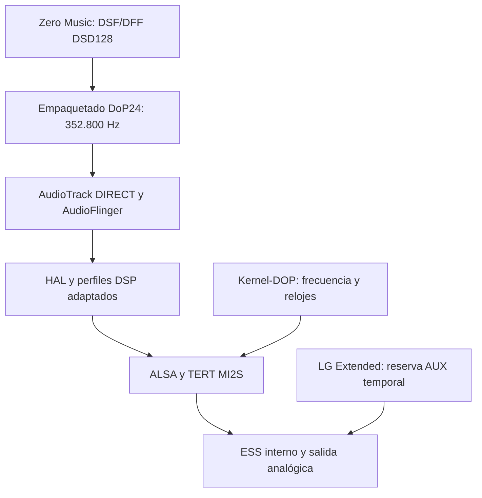

<div align="center">

# V60 · Audio Lab

### Del archivo DSD al ESS. Cada etapa, a la vista.

**El laboratorio que conecta Kernel-DOP, Zero Music y LG Extended.**


Código, recetas y resultados. Sin confundir una frecuencia solicitada con una señal medida.

</div>

---

## Qué es esto

Este repositorio documenta el trabajo que permitió reproducir **DSD128 por DoP mediante el Quad DAC interno y el jack del LG V60**. Reúne las piezas del laboratorio que no pertenecen al kernel ni a las aplicaciones: transformaciones del HAL y las políticas de audio, configuración de referencia, inspección del ramdisk y una guía de integración.

También comprobamos un fragmento real de DoP con datos DSD intactos antes de la entrega al HAL. No se presenta como una certificación eléctrica bit-perfect del DAC ni como un instalador para cualquier ROM.

## El mapa



| Pieza | Dónde vive |
| :--- | :--- |
| Kernel y compilación | [Kernel-DOP](https://github.com/zXer0z/Kernel-DOP), revisión publicada `641fc1370` |
| Transformaciones, referencias y guía | **Este repositorio** |
| Reproductor | Zero Music `1.0.8-beta14` / código 143; fuentes en proyecto separado, sin URL publicada aquí todavía |
| Control del DAC | LG Extended `1.1.0-beta3` / código 4, protocolo de coordinación 2; fuentes en proyecto separado |

## Qué contiene

```text
recipes/                 Receta exacta por hash para seis archivos de audio
patches/vendor/          Diffs legibles de las configuraciones
patches/kernel/          Diff del kernel sobre la base QCloud fijada
scripts/generate.py      Generación local de candidatos, sin tocar el teléfono
scripts/capture-state.sh Instantánea de estado, sin cambiar audio ni volumen
scripts/inspect-ramdisk.py Comparación de dos ramdisks CPIO locales
reference/               Configuración del kernel y acción init usada
docs/                    Integración, evidencia, diagnóstico y alcance
```

**No contiene:** HAL propietario completo, `boot.img`, ramdisk con Magisk, APK, módulos instalables, música, claves de firma ni capturas del teléfono. Las recetas usan archivos que debes aportar localmente y rechazan otros hashes.

## Equipo de referencia

- LG V60 **Timelm**, placa `Timelm_lao rev_1.01`, Android 13.
- Kernel de referencia `4.19.325-v60-dop-lab3+`.
- HAL de audio **ARM32**, aunque Android y el SoC sean de 64 bits.
- Quad DAC activo, reloj X-tal y salida analógica; AUX temporal durante DoP.
- Portadora **352.800 Hz**, estéreo, PCM24 empaquetado (`S24_3LE` en ALSA), con marcadores DoP `05/FA`.

La matriz exacta, fingerprint y hashes están en la [receta](recipes/timelm-dop128-24.json) y en [compatibilidad](docs/COMPATIBILITY.md). No se ha validado esta solución para otros V60, ROM, revisiones de placa o HAL.

## Generar los candidatos sin conectarse al teléfono

Necesitas Python 3.9 o posterior. No hay dependencias Python externas.

1. Conserva tus archivos originales fuera de Git.
2. Consulta los hashes de entrada en la receta: deben coincidir **exactamente** con la revisión de referencia.
3. Coloca los seis archivos en `inputs/`, con los nombres indicados por la receta.
4. Ejecuta:

```bash
python3 scripts/generate.py --input-dir inputs --output-dir outputs/dop24
```

El comando valida todos los originales antes de crear la salida, aplica cambios acotados, comprueba los hashes finales y escribe un manifiesto. No sobrescribe una salida existente. **No usa ADB, no monta archivos, no reinicia servicios ni flashea particiones.**

Si no coinciden los hashes, la receta no sirve para tus archivos. No elimines las comprobaciones para hacerla pasar. La política de entrada es la copia del archivo que Android cargaba antes de los cambios del laboratorio; un overlay ya aplicado no es un original válido.

Generar candidatos no significa que estén instalados o que tu hardware haya sido validado. La preparación de una imagen de arranque depende de la ROM y se explica, con sus límites, en [integración](docs/INTEGRATION.md).

## Qué logramos y qué sigue pendiente

| Estado | Resultado |
| :--- | :--- |
| Confirmado por escucha | Reproducción DSD128 limpia y continua en el equipo de referencia. |
| Verificado en software | ALSA a 352,8 kHz / `S24_3LE`, MI2S correspondiente y DoP activo en la HAL. |
| Datos comprobados | 1.920 tramas con marcadores correctos; 7.680 bytes DSD idénticos al fragmento fuente. |
| Coordinación funcional | Las selecciones Normal/Alta/AUX se conservan; durante DoP se reserva AUX temporalmente. |
| No certificado | Último enlace eléctrico I²S, decodificación inequívoca del ESS y pista completa bit-perfect. |
| Pendiente de validación completa | Pausa/reanudación, búsqueda y continuidad prolongada en la última beta. |
| No validado | PCM a 384 kHz por el ESS, otras placas/ROM y otros modos DSD. |

Ver [evidencia y límites](docs/EVIDENCE.md). Una frecuencia aceptada por AudioTrack, `HAL is_dop=true` o un bloqueo de reloj no sustituyen la comprobación del contenido y la ruta.

## Documentación

- [Integración de las piezas y orden de arranque](docs/INTEGRATION.md)
- [Compatibilidad y versiones fijadas](docs/COMPATIBILITY.md)
- [Evidencia, registros y límites](docs/EVIDENCE.md)
- [Problemas conocidos y recuperación](docs/TROUBLESHOOTING.md)
- [Procedencia y licencias](docs/LICENSING.md)

Las pruebas funcionales las realiza el usuario. Esta publicación no instala ni ejecuta pruebas automáticamente y no incluye flujos de GitHub Actions.

## Créditos y licencia

Integración del proyecto: **zXer0z**. Gracias a Linux, Qualcomm, LG, ESS y los contribuidores de [QCloud](https://github.com/aqbaloch6205/LGV60_Timelm_Qcloud_Kernel), cuya base permitió este trabajo.

El código y la documentación originales de este laboratorio se publican bajo **GPL-2.0-only**, conforme a [LICENSE](LICENSE). Los parches del kernel mantienen la licencia y atribución de sus fuentes; los archivos de terceros conservan sus propios términos. Consulta [NOTICE](NOTICE) y [licencias](docs/LICENSING.md). Esta licencia no concede derechos sobre binarios propietarios aportados por el usuario.

**Más vida para el V60. Más claridad para su audio.**
